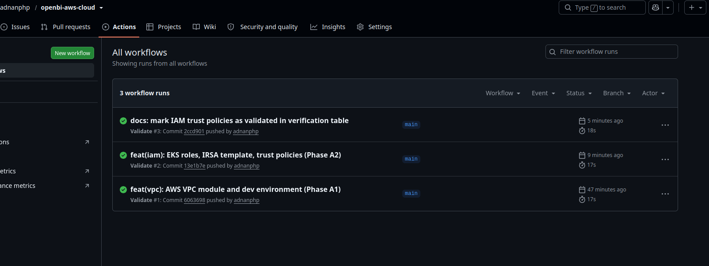
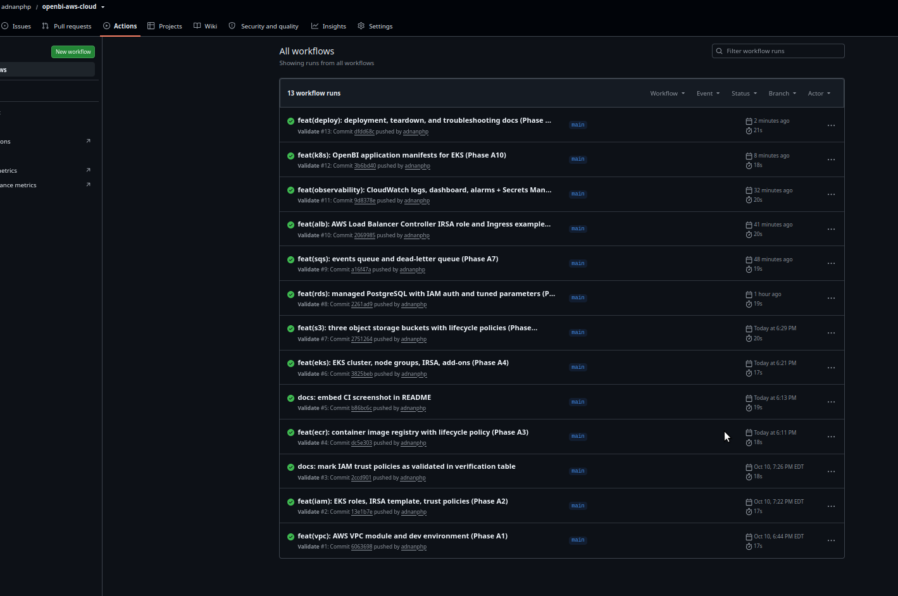
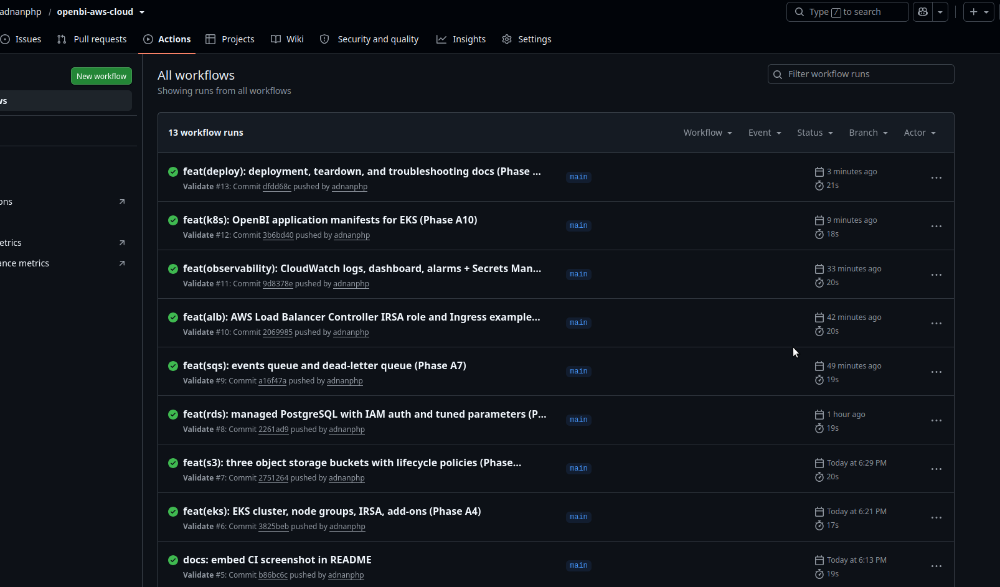

<div align="center">

# ☁️ OpenBI on AWS

### From Local Data Platform to Cloud-Native Infrastructure

**A Terraform-based AWS deployment architecture for [OpenBI](https://github.com/adnanphp/openbi), connecting business intelligence, data engineering, machine learning, and cloud infrastructure.**

<br>

[](https://github.com/adnanphp/openbi-aws-cloud/actions/workflows/validate.yml)
[](https://developer.hashicorp.com/terraform)
[](https://aws.amazon.com/)
[](https://kubernetes.io/)
[](https://boto3.amazonaws.com/v1/documentation/api/latest/index.html)
[](LICENSE)

<br>

**Infrastructure as Code · Kubernetes · IAM Security · Cloud Observability · Automated Validation**

[Architecture](#-architecture) ·
[Features](#-features) ·
[Project Structure](#-project-structure) ·
[Validation](#-validation-and-ci) ·
[Deployment](#-deployment) ·
[Roadmap](#-implementation-roadmap)

</div>

---

## 🎯 Project Overview

**OpenBI on AWS** is the cloud infrastructure companion to the original [OpenBI platform](https://github.com/adnanphp/openbi).

The original platform provides a local Business Intelligence and Data Engineering environment. This repository develops its AWS deployment configuration using Terraform, Kubernetes manifests, IAM policies, Python SDK examples, and automated validation workflows.

The goal is to translate a locally operated data platform into an AWS-oriented architecture using managed services where appropriate.

Rather than depending on permanently running cloud resources during development, this project emphasizes:

- Infrastructure defined and version-controlled as code.
- Automated static validation through GitHub Actions.
- Security-conscious IAM and network configuration.
- Documented deployment, operational, and teardown procedures.
- Transparent verification status and cost considerations.
- Reproducible development without requiring continuous AWS spending.

> **Verification status:** The repository's infrastructure configuration has passed the static checks documented in its CI workflow. It has not been deployed end-to-end to a live AWS account. A successful CI run does not establish that the complete architecture works in AWS.

---

## 🏗️ Architecture

The architecture maps components from the local OpenBI platform to corresponding AWS services.

| Local OpenBI component | AWS counterpart | Purpose |
|---|---|---|
| Kubernetes / Kind | Amazon EKS | Managed Kubernetes orchestration |
| Traefik ingress | Application Load Balancer + AWS Load Balancer Controller | Application traffic routing |
| MinIO | Amazon S3 | Object storage |
| PostgreSQL | Amazon RDS for PostgreSQL | Managed relational database |
| LocalStack S3/SQS | Amazon S3 and Amazon SQS | Cloud object storage and messaging |
| OpenFaaS | AWS Lambda | Serverless function architecture |
| Loki and Promtail | Amazon CloudWatch Logs | Centralized logging |
| Prometheus and Grafana | Amazon Managed Service for Prometheus and Amazon Managed Grafana | Managed monitoring architecture |
| Docker images | Amazon ECR | Container image registry |
| Kubernetes Secrets | AWS Secrets Manager + External Secrets Operator | Externalized application secrets |
| Redis | Amazon ElastiCache for Valkey or Redis OSS, subject to service availability and requirements | Managed caching |
| Kafka | Amazon MSK or an appropriate AWS messaging service | Managed event-streaming architecture |

These are architectural mappings, not claims that every local service has already been migrated or that every AWS counterpart behaves identically.

For example, SQS is suitable for queue-based messaging but is not a drop-in replacement for Kafka's distributed event-streaming model. Likewise, AWS Lambda and OpenFaaS have different execution and deployment models.

See the [OpenBI cloud-mapping documentation](https://github.com/adnanphp/openbi/blob/main/docs/cloud-mapping.md) for the broader mapping.

### High-level architecture

```text
                         Developers
                              |
                              v
                    GitHub Repository
                              |
                              v
                    GitHub Actions CI
                              |
                  Static validation checks
                              |
                              v
                    Terraform Configuration
                              |
            +-----------------+-----------------+
            |                 |                 |
            v                 v                 v
       Networking          Security        Infrastructure
          VPC                IAM          EKS, ECR, S3
                                            RDS, SQS
                                                |
                                                v
                                      Kubernetes Workloads
                                                |
                           +--------------------+------------------+
                           |                    |                  |
                           v                    v                  v
                       FastAPI              Superset         AWS Services
                           |                    |                  |
                           +--------------------+------------------+
                                                |
                                                v
                                      CloudWatch and Alerts
```

The diagram represents the intended deployment architecture. It does not indicate that the resources have already been created in AWS.

---

## ✨ Features

### 1. Infrastructure as Code

Terraform modules organize the infrastructure into reusable components.

- VPC and network resources.
- EKS cluster and managed node groups.
- IAM roles, policies, and trust relationships.
- ECR repositories and lifecycle policies.
- S3 buckets, encryption, and lifecycle management.
- RDS for PostgreSQL.
- SQS queues and dead-letter queues.
- Application Load Balancer integration.
- CloudWatch logging, dashboards, and alarms.

The development environment composes these modules into a consistent configuration.

### 2. Security-conscious infrastructure

Security is incorporated into the design through:

- Private database networking.
- IAM roles and least-privilege policy design.
- EKS OIDC integration and IAM Roles for Service Accounts (IRSA).
- S3 public-access blocking.
- Encryption and secure-transport policies.
- AWS Secrets Manager integration.
- Kubernetes external-secret configuration.
- Documented IAM trust policies.

These configurations require further review and, where applicable, live integration testing before their operational behavior can be considered verified.

### 3. Kubernetes application deployment

The `kubernetes/` directory contains OpenBI application manifests adapted for the planned EKS deployment.

The current configuration includes:

- Kustomize base and development overlay.
- FastAPI deployment and service.
- Superset deployment and service.
- ConfigMaps for non-secret configuration.
- ExternalSecret resources for database credentials.
- Ingress resources for ALB integration.
- Fluent Bit and CloudWatch agent configuration.

The manifests are designed around AWS-managed infrastructure rather than deploying every local dependency inside Kubernetes.

### 4. Data storage and messaging

The infrastructure configuration includes:

- Three S3 buckets for raw data, processed data, and models.
- Bucket versioning where configured.
- Encryption and lifecycle policies.
- RDS for PostgreSQL.
- IAM database authentication configuration.
- Automated backup and recovery settings.
- SQS event queues and dead-letter queues.
- Python examples using `boto3`.

### 5. Observability

The CloudWatch configuration includes:

- Log groups with configured retention.
- A dashboard for infrastructure and service monitoring.
- Alarms for selected RDS, SQS, and ALB metrics.
- An SNS notification topic.
- Kubernetes logging and metrics integration.

The presence of these configurations does not establish that live metrics, logs, or notifications have been tested against deployed resources.

### 6. Deployment and operations

The repository includes scripts and documentation intended to support the deployment lifecycle:

- Static validation.
- Deployment orchestration.
- Teardown procedures.
- Deployment status inspection.
- Troubleshooting.
- Cost-awareness and cleanup guidance.

Deployment commands are separated from static validation so that checking the configuration does not require creating cloud resources.

---

## 🧰 Technology Stack

| Category | Technologies |
|---|---|
| Cloud | Amazon Web Services |
| Infrastructure as Code | Terraform |
| Container orchestration | Kubernetes, Amazon EKS |
| Container registry | Amazon ECR |
| Networking | VPC, subnets, route tables, security groups, ALB |
| Identity and access | IAM, OIDC, IRSA |
| Object storage | Amazon S3 |
| Relational database | Amazon RDS for PostgreSQL |
| Messaging | Amazon SQS |
| Secrets | AWS Secrets Manager, External Secrets Operator |
| Observability | Amazon CloudWatch, SNS |
| Application platform | OpenBI, FastAPI, Superset |
| AWS SDK | Python, boto3 |
| CI | GitHub Actions |
| Validation | Terraform, TFLint, JSON validation |

---

## 📂 Project Structure

```text
openbi-aws-cloud/
├── .github/
│   └── workflows/
│       └── validate.yml
│
├── terraform/
│   ├── modules/
│   │   ├── vpc/
│   │   ├── iam/
│   │   ├── ecr/
│   │   ├── eks/
│   │   ├── s3/
│   │   ├── rds/
│   │   ├── sqs/
│   │   ├── alb/
│   │   └── cloudwatch/
│   │
│   └── environments/
│       └── dev/
│
├── kubernetes/
│   ├── openbi-app/
│   ├── external-secrets/
│   ├── ingress/
│   ├── observability/
│   └── README.md
│
├── iam/
│   ├── policies/
│   ├── trust-policies/
│   └── README.md
│
├── scripts/
│   ├── validate.sh
│   ├── deploy.sh
│   ├── teardown.sh
│   └── status.sh
│
├── python/
│   ├── s3_operations.py
│   ├── sqs_operations.py
│   └── rds_connection.py
│
├── docs/
│   ├── architecture.md
│   ├── verification.md
│   ├── iam-overview.md
│   ├── eks.md
│   ├── s3.md
│   ├── rds.md
│   ├── sqs.md
│   ├── alb.md
│   ├── cloudwatch.md
│   ├── secrets.md
│   ├── eks-deployment.md
│   ├── deployment.md
│   ├── teardown.md
│   ├── troubleshooting.md
│   └── images/
│       ├── workflows_01.png
│       ├── workflows_02.png
│       └── workflows_03.png
│
├── ROADMAP.md
├── README.md
└── LICENSE
```

This tree summarizes the major components. Consult the repository for the authoritative current file list.

---

## 🚦 Validation and CI

Every push that matches the workflow's configured triggers runs automated validation.

The CI workflow is designed to check infrastructure code and configuration without requiring AWS credentials or creating cloud resources.

### Validation checks

| Check | Purpose |
|---|---|
| `terraform fmt -check` | Checks Terraform formatting |
| `terraform validate` | Checks Terraform configuration syntax and internal consistency |
| TFLint | Performs configured Terraform linting checks |
| JSON validation | Checks the syntax of relevant JSON policy files |

The exact checks and their scope are defined by [`.github/workflows/validate.yml`](.github/workflows/validate.yml) and [`scripts/validate.sh`](scripts/validate.sh).

A passing check means that the corresponding validation completed successfully. It does not prove that AWS will accept every resource configuration or that the infrastructure will deploy and operate correctly.

### Run validation locally

Prerequisites:

- Terraform 1.5.0 or later.
- Bash.
- TFLint, if required by the validation script.

Clone the repository:

```bash
git clone https://github.com/adnanphp/openbi-aws-cloud.git
cd openbi-aws-cloud
```

Run the validation script:

```bash
./scripts/validate.sh
```

You can also run the Terraform formatting and validation checks independently from the relevant Terraform directories:

```bash
terraform fmt -check -recursive terraform/
```

For an environment that has its provider dependencies initialized:

```bash
terraform -chdir=terraform/environments/dev validate
```

Terraform validation requires initialization. If the providers have not been initialized, initialize the directory first:

```bash
terraform -chdir=terraform/environments/dev init -backend=false
terraform -chdir=terraform/environments/dev validate
```

These commands do not run `terraform apply`. Provider initialization may download provider packages, but it does not provision the defined infrastructure.

---

## 📸 GitHub Actions: Validation History

The following screenshots document selected checkpoints in the repository's CI history.

### Phase A1–A3: Infrastructure foundation

Initial VPC and IAM work, followed by the ECR module.



### Phase A4–A7: Core AWS services

EKS, S3, RDS, and SQS configuration.



### Phase A8–A11: Operations and deployment configuration

ALB integration, CloudWatch, Kubernetes manifests, and deployment documentation.



**View the live workflow history:** [GitHub Actions — Validate](https://github.com/adnanphp/openbi-aws-cloud/actions/workflows/validate.yml)

The screenshots show workflow results at selected points in development. They are not substitutes for live AWS deployment tests.

---

## 🗺️ Implementation Roadmap

The repository is organized into implementation phases.

| Phase | Component | Scope |
|---|---|---|
| A1 | VPC and networking | VPC, subnets, routing, and security groups |
| A2 | IAM and security | EKS roles, IRSA templates, and trust policies |
| A3 | ECR | Container repository and lifecycle policy |
| A4 | EKS | Cluster, node groups, OIDC, and add-ons |
| A5 | S3 | Object storage, encryption, and lifecycle policies |
| A6 | RDS | Managed PostgreSQL, authentication, and backups |
| A7 | SQS | Events queue and dead-letter queue |
| A8 | ALB | Load Balancer Controller integration and Ingress examples |
| A9 | Observability | CloudWatch logs, dashboard, alarms, and secrets integration |
| A10 | Kubernetes application | OpenBI manifests and development overlay |
| A11 | Deployment operations | Deployment, teardown, status, and troubleshooting documentation |

See [`ROADMAP.md`](ROADMAP.md) for the project roadmap and [`docs/verification.md`](docs/verification.md) for the current verification status.

The phase list describes implementation work in the repository. It does not imply that every component has been deployed or integration-tested against live AWS services.

---

## 💰 Cost Awareness

Cloud infrastructure can incur charges even when an application is not actively processing data.

This project is developed with a cost-conscious approach:

- Static validation runs without provisioning AWS infrastructure.
- Terraform configurations can be inspected and validated locally.
- Deployment scripts provide a place to centralize deployment safeguards.
- Teardown documentation explains how to remove resources after testing.
- Real-cloud deployment should be deliberate rather than an automatic consequence of a CI run.

### Potential AWS costs

The following services can generate charges when provisioned:

| Service | Cost consideration |
|---|---|
| Amazon EKS | Cluster control-plane charges and worker compute |
| NAT Gateway | Hourly charges and data processing |
| EC2 worker nodes | Instance runtime and associated storage |
| Amazon RDS | Database instance runtime, storage, and related features |
| Application Load Balancer | Load-balancer runtime and usage |
| Amazon S3 | Storage, requests, and data transfer |
| Amazon ECR | Container image storage |
| CloudWatch | Log ingestion, storage, metrics, and alarms |
| Amazon SQS | Requests and related usage |

Actual costs depend on the selected region, resource sizes, configuration, and usage. This README does not claim a verified current cost estimate for the complete architecture.

Before provisioning resources, consult the [AWS Pricing Calculator](https://calculator.aws/) and the pricing pages for the selected services.

**Important:** Destroying Terraform-managed resources does not necessarily remove every separately created resource or recover data. Review the resource inventory, state, deletion protection, persistent storage, and any retained data before running teardown commands.

---

## 🔐 Verification and Deployment Boundaries

This repository distinguishes between code validation and actual cloud operation.

| Layer | What the project establishes |
|---|---|
| Terraform formatting | The configured formatting check passes |
| Terraform validation | The configured Terraform validation passes |
| Terraform linting | The configured TFLint check passes |
| IAM trust policies | JSON syntax is validated; policies have not been applied |
| Kubernetes manifests | Configuration is present in the repository; live EKS behavior is not established by static validation |
| Python SDK examples | Source code is available; live AWS operations require suitable credentials and resources |
| End-to-end deployment | Not verified against a live AWS account |

Static checks cannot fully verify:

- Whether the selected AWS account and region support the intended resources.
- Whether all IAM permissions are sufficient and appropriately scoped.
- Whether subnet capacity and network routing are correct in a deployed environment.
- Whether EKS workloads can access their required AWS services.
- Whether DNS, TLS certificates, ingress routing, and health checks work end-to-end.
- Whether all managed services interact as intended at runtime.

See [`docs/verification.md`](docs/verification.md) for the detailed verification record.

---

## 🚀 Deployment

The repository includes a deployment guide and scripts for a future real-AWS deployment.

Before attempting deployment:

1. Review [`docs/architecture.md`](docs/architecture.md).
2. Read [`docs/verification.md`](docs/verification.md).
3. Review the prerequisites in [`docs/deployment.md`](docs/deployment.md).
4. Check the expected AWS resources and estimated costs.
5. Verify the AWS account, region, Terraform state configuration, and credentials.
6. Understand the teardown procedure before creating resources.

The deployment script is intended to support a dry-run-first workflow. Review its current implementation and command-line options before using it.

For operational guidance, see:

- [`docs/deployment.md`](docs/deployment.md)
- [`docs/teardown.md`](docs/teardown.md)
- [`docs/troubleshooting.md`](docs/troubleshooting.md)

**This repository is not presented as a successfully deployed AWS environment.** A live deployment should only be claimed after the required resources have been provisioned and the relevant integration and runtime checks have passed.

---

## 🔗 Related Projects

| Repository | Description |
|---|---|
| [OpenBI](https://github.com/adnanphp/openbi) | Main Business Intelligence and Data Engineering platform |
| [OpenBI Desktop](https://github.com/adnanphp/openbi-desktop) | Native Linux desktop client for OpenBI |
| [OpenBI AWS Cloud](https://github.com/adnanphp/openbi-aws-cloud) | AWS infrastructure and deployment configuration |
| [OpenBI GCP Cloud](https://github.com/adnanphp/openbi-gcp-cloud) | Planned Google Cloud counterpart |

---

## 🎓 What This Project Explores

This project brings together several areas of practical engineering:

- Infrastructure as Code and reusable Terraform modules.
- Cloud networking and infrastructure composition.
- IAM security and workload identity.
- Managed Kubernetes and container registries.
- Object storage, relational databases, and queue-based messaging.
- Cloud logging, monitoring, and alerting.
- Python SDK integration with cloud services.
- Automated configuration validation.
- Deployment documentation and cost-conscious development.

The emphasis is on understanding how the pieces fit together, making the configuration inspectable, and distinguishing automated checks from claims that require a running environment.

---

## 📄 License

This project is licensed under the MIT License. See [`LICENSE`](LICENSE) for details.

---

<div align="center">

### OpenBI on AWS

**Build deliberately. Validate continuously. Document honestly.**

[](https://github.com/adnanphp/openbi-aws-cloud)
[](https://github.com/adnanphp/openbi-aws-cloud/actions)

</div>
